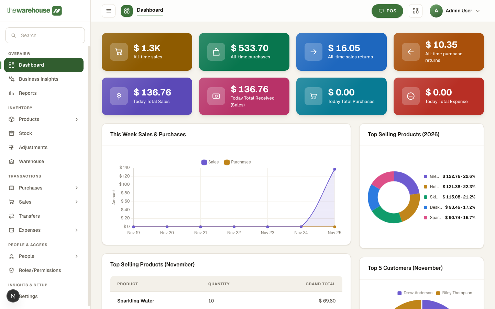
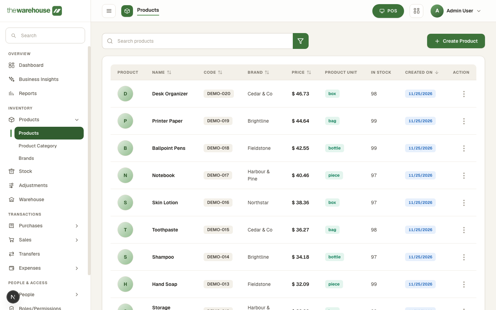
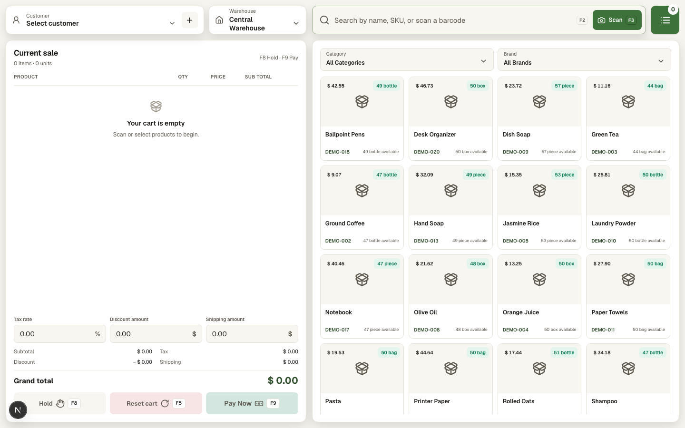
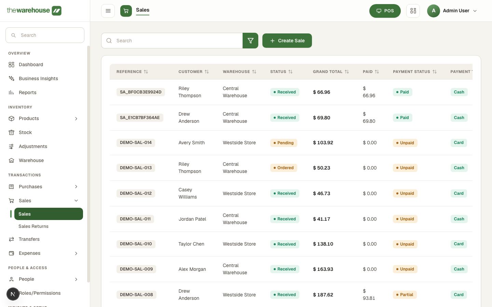

# The Warehouse - Inventory Management System

<div align="center">



**A complete, role-based inventory and sales platform for modern warehouse operations.**

</div>

Inventory is a web-based system for managing products, stock, warehouses, suppliers, customers, and staff accounts. It includes role-based access, purchases and sales with returns, stock adjustments, transfers, expenses, reports, a point-of-sale screen, and AI-assisted business insights.

## Features

- **Inventory control** - Products, categories, brands, units, warehouse stock, alerts, and stock movements
- **Purchasing** - Purchase orders, delivery status, suppliers, returns, and received-stock posting
- **Sales** - Sales orders, payments, customers, returns, and POS checkout
- **Warehouse operations** - Adjustments, inter-warehouse transfers, and status-aware stock reconciliation
- **Finance and reporting** - Expenses, expense categories, sales/purchase reports, stock reports, and warehouse reports
- **Team administration** - Users, roles, granular permissions, account history, and login protection
- **Business intelligence** - Dashboard charts and on-demand OpenAI business insights
- **Configurable branding** - Application name, favicon, and header logo
- **International-ready addresses** - Structured country, region, city, suburb, postal code, and street data

## Technology Stack

| Area | Technology |
| --- | --- |
| Framework | Next.js 16 App Router, React 19 |
| Language | TypeScript |
| Database | MySQL or MariaDB |
| ORM | Prisma 7 |
| Authentication | Auth.js / NextAuth |
| Charts | Chart.js |
| Styling | Tailwind CSS 4 |
| Documents | PDFKit and ExcelJS |
| AI | OpenAI Responses API |

## Showcase

### Product Catalog

Search, filter, and manage products, pricing, units, brands, categories, and warehouse availability.



### Point of Sale

Process in-person sales from a responsive POS interface with warehouse selection, customer lookup, stock-aware products, discounts, tax, and payment controls.



### Sales Management

Track sales references, customers, warehouses, fulfillment status, payment status, and totals from a searchable sales workspace.



## Core workflows

The **Stock** page (`/stock`) organizes on-hand balances by warehouse and is available to roles with the `View Stock` permission. Warehouse setup remains on the separate Warehouse page; changes to quantities continue through the existing purchase, return, adjustment, and transfer workflows.

### Inventory posting rules

Only stock with a **Received** status counts as sellable on-hand inventory. Pending or ordered purchases remain outside on-hand stock until received; pending or ordered sales reserve received stock, while received sales deduct it. Purchase and sale returns affect stock only when received. Alternate transaction units require a product-specific conversion factor, which is saved with each transaction line so later product changes do not reinterpret historical quantities.

The status-aware stock migration adds the reservation and conversion fields but does not reconstruct them for historical transactions. It is intended for a fresh database; before applying it to a database with existing sales or returns, reconcile pending/ordered sales and non-received returns against current stock.

Role permissions separate read access from changes: **View** grants read-only access to a resource, while **Manage** grants write access and includes its matching View permission. Existing roles that have Manage permissions continue to receive the implied View access.

Administrators can update the application name, favicon, and header logo from Settings. The header logo accepts PNG, JPEG, or WebP images up to 2 MB; after replacing it, apply the checked-in database migrations to make the new setting available.

## Project Setup

Follow these steps to prepare a local development environment: install dependencies, connect the app to MySQL or MariaDB, apply the database schema, create the initial administrator account, and start the development server.

### Requirements

- Node.js 20.9 or newer
- npm
- MySQL or MariaDB

### Install and configure

1. From the repository root, install dependencies:

   ```bash
   npm ci
   ```

2. Create an empty MySQL or MariaDB database for the application.

3. Create a `.env` file in the repository root:

   ```env
   DB_HOST=127.0.0.1
   DB_PORT=3306
   DB_USERNAME='root'
   DB_PASSWORD=''
   DB_DATABASE='nextinventory'
   AUTH_SECRET="replace-with-a-random-secret"
   OPENAI_API_KEY=""
   # Optional; defaults to gpt-4.1-mini for business insights.
   OPENAI_BUSINESS_INSIGHTS_MODEL="gpt-4.1-mini"
   # Set to true only when a trusted reverse proxy overwrites X-Forwarded-For.
   AUTH_TRUST_PROXY_IP="false"
   ADMIN_EMAIL="admin@example.com"
   ADMIN_PASSWORD="choose-a-strong-password"
   NEXT_PUBLIC_APP_NAME="Inventory Management System"
   NEXT_PUBLIC_APP_URL="http://localhost:3000"

   # Optional account details
   ADMIN_FIRST_NAME="Admin"
   ADMIN_LAST_NAME="User"
   ADMIN_PHONE_NUMBER=""
   ADMIN_IMAGE=""
   ```

   TiDB Cloud hosts automatically use certificate-verified TLS. Generate an authentication secret, for example with `openssl rand -base64 32`. Keep `.env` private; it is ignored by git.

4. Generate the Prisma client and apply the checked-in database migrations:

   ```bash
   npx prisma generate
   npx prisma migrate deploy
   ```

5. Seed the default walk-in customer and administrator account:

   ```bash
   npx prisma db seed
   ```

   The seed script creates the walk-in customer and an `admin` role with all permissions, then upserts the administrator using `ADMIN_EMAIL`. It hashes `ADMIN_PASSWORD` with bcrypt before storing it. Rerunning the seed updates the matching administrator's details and password hash.

   To also insert the optional standard demo preset, run:

   ```bash
   SEED_DEMO_DATA=true npx prisma db seed
   ```

   The standard preset creates or updates demo warehouses, suppliers, customers, categories, brands, units, products, per-product alternate-unit conversions, stock balances, purchases, sales, returns, transfers, expenses, and stock movements. Sales and purchases include received and pending/ordered examples: pending/ordered purchase quantities are stored in their own stock buckets, while pending/ordered sales reserve received stock without reducing physical on-hand quantities. Transaction lines save their stock conversion factor. Demo records use fixed `demo-` IDs/references so rerunning the preset updates those records rather than duplicating them; it does not delete records. Apply database migrations first, and verify that the configured database is the intended local or staging database before running the command.

6. Start the development server:

   ```bash
   npm run dev
   ```

Open [http://localhost:3000](http://localhost:3000) and sign in with the configured `ADMIN_EMAIL` and `ADMIN_PASSWORD`.

### Environment variables

Credential sign-in is throttled after 5 failed attempts per email/IP pair and 20
failed attempts per IP in a 15-minute window. When no trusted client IP is
configured, the fallback is 30 failed attempts per email. A threshold triggers a
15-minute lockout. These limits are stored in the database; apply the checked-in
`LoginAttemptBucket` migration before deploying this version.

To keep login requests from sweeping expired rate-limit rows, schedule
`npm run auth:cleanup-login-attempts` to run daily. It removes buckets older than
30 days. Set `AUTH_TIMING_LOGS=true` temporarily to log credential sign-in stage
durations (rate-limit lookup, user query, password check, and counter cleanup);
the timing log contains no account or credential values.

| Variable | Required | Purpose |
| --- | --- | --- |
| `DB_HOST` | Yes | MySQL/MariaDB server hostname or IP address. |
| `DB_PORT` | Yes | MySQL/MariaDB server port. |
| `DB_USERNAME` | Yes | Database username. |
| `DB_PASSWORD` | Yes | Database password; may be empty for local development. |
| `DB_DATABASE` | Yes | Database name. |
| `AUTH_SECRET` | Yes | Secret used to sign authentication tokens. |
| `OPENAI_API_KEY` | No | Server-side OpenAI API key used for on-demand business insights. Without it, the insights page reports that AI is not configured. |
| `OPENAI_BUSINESS_INSIGHTS_MODEL` | No | OpenAI model for business insights; defaults to `gpt-4.1-mini`. |
| `AUTH_TRUST_PROXY_IP` | No | Set to `true` only when a trusted reverse proxy overwrites `X-Forwarded-For`; enables per-IP login throttling. |
| `AUTH_TIMING_LOGS` | No | Set to `true` temporarily to log credential sign-in stage durations without personal data. |
| `ADMIN_EMAIL` | Yes, for seeding | Email address for the initial administrator account. |
| `ADMIN_PASSWORD` | Yes, for seeding | Initial administrator password. |
| `SEED_DEMO_DATA` | No | Set to `true` for one seed run to upsert the standard demo dataset. |
| `ADMIN_FIRST_NAME` | No | Administrator first name; defaults to `Admin`. |
| `ADMIN_LAST_NAME` | No | Administrator last name; defaults to `User`. |
| `ADMIN_PHONE_NUMBER` | No | Administrator phone number. |
| `ADMIN_IMAGE` | No | Administrator avatar URL. |
| `NEXT_PUBLIC_APP_NAME` | No | App name shown in the interface; defaults to `Inventory`. |
| `NEXT_PUBLIC_APP_URL` | No | Absolute HTTP(S) public app URL used for metadata; defaults to `http://localhost:3000`. Invalid values are reported and omitted from metadata. |
| `COUNTRIES_API_BASE_URL` | No | Countries.dev API base URL. Country options use local phone metadata when unset; city and postal-code suggestions then remain unavailable and can be entered manually. Set this to `https://countries.dev` to enable those lookups. |
| `GEOGRAPHY_DATA_DIR` | No | Directory for GeoNames archives; defaults to `.data/geonames`. Country and postal archives are downloaded on first use and cached locally for 30 days. |
| `OSM_NOMINATIM_BASE_URL` | No | URL of a self-hosted Nominatim instance for the optional street-search endpoint. Public OpenStreetMap search servers are explicitly rejected. |

### AI business insights

The dashboard links to a separate **Business Insights** page. Access is controlled by the **View Business Insights** role permission; grant it to roles that should access the page and generate provider requests. Generating insights is on demand. The application calculates the last two completed UTC weeks of received sales less received sales returns and expenses, plus current outstanding balances and low-stock position counts. It sends only those aggregate facts to OpenAI; customer and supplier identities, transaction records, and notes are not sent. The response is limited to recommendations tied to the supplied facts, is not persisted, and should be reviewed before acting. No profit or margin estimate is provided.

OpenAI Responses requests set `store` to `false`; OpenAI's abuse-monitoring retention policies may still apply. Review the provider's data controls and terms for your account before enabling this feature.

### Global address data

The shared warehouse, customer, supplier, POS customer, and product-reference forms use a flexible location hierarchy. Administrative levels appear only when GeoNames has child areas for the selected parent. City, suburb, and postal-code suggestions are optional; street, building, and unit details are entered manually in one **Address** field. The form shows a live address preview and stores structured address details plus per-location source/manual provenance. The existing `address` column remains populated for older sales, purchase, and PDF views.

The implementation uses only these sources:

- **Countries.dev** supplies country metadata, unscoped city suggestions, and supported postal-code matches. Its hosted API advertises free access without an API key, but public rate limits and uptime are not guaranteed. Its city results focus on major cities, and postal-code coverage is incomplete. No paid fallback is configured.
- **GeoNames** country and postal-code archives are fetched from the official download site on first use, streamed and cached under `GEOGRAPHY_DATA_DIR`, and used for administrative areas, scoped cities, suburbs, and postal codes. The datasets are free under [CC BY 4.0](https://creativecommons.org/licenses/by/4.0/) and require attribution. The separate GeoNames web API is not used; it requires a registered account and is limited to 10,000 credits per day and 1,000 per hour.
- **OpenStreetMap** street search is available only through an operator-configured, self-hosted Nominatim endpoint; the shared forms use manual address entry instead. The public Nominatim service is not used for autocomplete. OSM data is licensed under the [ODbL](https://www.openstreetmap.org/copyright), which requires attribution and may require share-alike distribution of adapted databases. Nominatim is free software, but self-hosting requires operator-provided storage and compute resources; a full-planet deployment has substantial hardware requirements.

No Google, Mapbox, commercial geocoder, subscription, trial, or usage-billed service is integrated. Location suggestions may be unavailable because of source coverage, connectivity, or a local service not being configured; the forms do not silently switch providers.

### Other useful commands

```bash
npm run build                       # Create a production build
npm run start                       # Serve the production build
npm run auth:cleanup-login-attempts # Remove expired login rate-limit buckets
npm run audit:cleanup-user-history  # Remove user history older than 12 months
```

Schedule `npm run audit:cleanup-user-history` to run daily, including while the module is disabled, so existing entries expire on time. The Settings page can pause new history entries; it does not erase existing entries. Admins can review retained events from the Users page, filter by user/action/date, and export up to 10,000 matching entries as CSV.

## Learn More

- [Next.js Documentation](https://nextjs.org/docs)
- [Prisma Documentation](https://www.prisma.io/docs)
- [Security policy](Security.md)

## Deploy

See the [Next.js deployment documentation](https://nextjs.org/docs/app/building-your-application/deploying) for deployment guidance.
